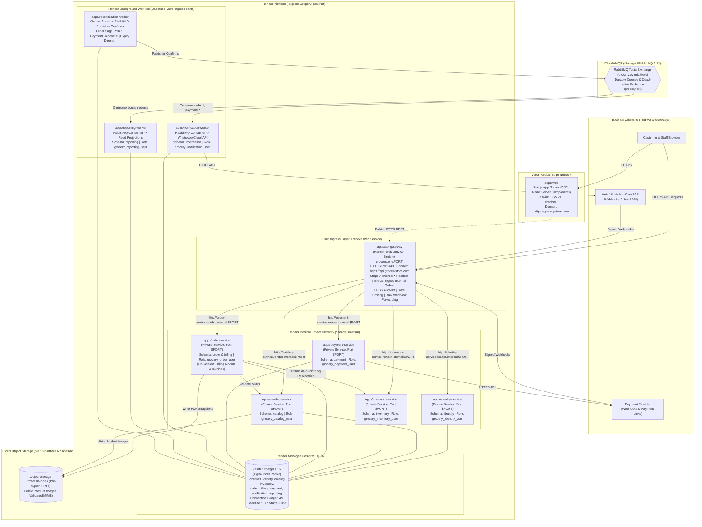

# System Architecture & Vercel + Render Deployment Topology

## Grocery Store Management & WhatsApp Ordering Platform

**Status:** Proposed Architecture Baseline (Fully Reconciled & Hardened)  
**Governing Documents:**  
- `Grocery_Store_Production_Architecture_Final_Specification_v2.pdf` (Primary Architecture Reference)  
- `Grocery_Store_Architecture_Implementation_Baseline_v3.pdf` (Implementation & Acceptance Baseline)  
- `STYLE.md` (Frontend UI & Styling Standard)  

---

## 1. Executive System Overview

The platform is a multi-tenant retail grocery management and customer ordering system. It enables neighborhood grocery merchants to manage their product catalog, track inventory balances, review incoming orders, process substitutions, generate itemized tax invoices, collect digital payments via payment links, and coordinate order delivery and pickup.

Customer and merchant interactions occur across two primary channels:
1. **Web Application:** Built with **Next.js (App Router)**, Tailwind CSS v4, and shadcn/ui per `STYLE.md`, deployed globally on **Vercel**.
2. **WhatsApp Ordering & Notifications:** Powered by the official **WhatsApp Business Platform Cloud API**, supporting conversational order submission, shopkeeper confirmation, and real-time status notifications.

Backend computation, persistence, and queue consumers are hosted on **Render**, **Render Postgres**, and **CloudAMQP**.

---

## 2. Reconciled Production Deployment Topology

The system topology reconciles logical service boundaries with concrete physical deployment primitives:



---

## 3. Reconciled Service & Deployable Count

To ensure absolute consistency across all project documentation and future deployment manifests (e.g. Render Blueprints), the platform deployable count is explicitly codified:

| Deployable Unit | Platform & Service Type | Ingress / Ports | Domain Ownership & Responsibilities |
| :--- | :--- | :--- | :--- |
| **`apps/web`** | **Vercel** (Next.js App Router) | Public Edge HTTPS | Customer shopping, staff review/fulfilment UI, admin settings per `STYLE.md`. |
| **`apps/api-gateway`** | **Render Web Service** | Public HTTPS (443 / `$PORT`) | Edge rate limiting, request IDs, CORS, public header sanitization, signed internal token generation, raw webhook routing. |
| **`apps/identity-service`** | **Render Private Service** | Private HTTP (`$PORT`) | Authentication, Argon2id credentials, session tokens, store memberships. |
| **`apps/catalog-service`** | **Render Private Service** | Private HTTP (`$PORT`) | Product catalog, variants/SKUs, canonical units, price versions. |
| **`apps/inventory-service`** | **Render Private Service** | Private HTTP (`$PORT`) | Stock balances, append-only movement ledger, atomic multi-item reservations. |
| **`apps/order-service`** | **Render Private Service** | Private HTTP (`$PORT`) | Order lifecycle state machine, review/revisions, saga coordinator, and co-located Billing module. |
| **`apps/payment-service`** | **Render Private Service** | Private HTTP (`$PORT`) | Payment attempts, provider adapter, webhook inbox, payment links, refund records. |
| **`apps/notification-worker`**| **Render Background Worker** | Zero Ingress Ports | Consumes RabbitMQ events; dispatches WhatsApp templates and emails. |
| **`apps/reporting-worker`** | **Render Background Worker** | Zero Ingress Ports | Consumes RabbitMQ events; writes read-optimized reporting projections. |
| **`apps/reconciliation-worker`**| **Render Background Worker** | Zero Ingress Ports | Polling Transactional Outbox publisher; payment status poller; reservation expiry daemon. |

**Total Deployment Footprint:**  
- 1 Vercel Frontend Application.  
- 1 Render Public Web Service (API Gateway).  
- 5 Render Private Services (Zero public attack surface).  
- 3 Render Background Workers (Daemons).  
- 1 Managed PostgreSQL 16 Instance (Schema-per-service on Render).  
- 1 Managed RabbitMQ Cluster (CloudAMQP proposed).  

---

## 4. Security Architecture & Three-Part Internal Authentication Contract

### 4.1 Gateway Ingress Credential Handling & Sanitization Sequence
Public clients and third-party webhooks enter through the API Gateway, which executes a strict 5-stage request-processing sequence:
1. **Receive External Request:** Edge ingress via public HTTPS.
2. **Authenticate & Validate External Credentials:** The Gateway validates incoming client credentials according to the route and client classification:
   - *Web Sessions (Next.js frontend):* Validates HttpOnly, Secure, SameSite session cookies via the Identity Service / session store.
   - *Mobile / Direct API Clients:* Validates standard HTTP `Authorization: Bearer <token>` credentials.
   - *External Webhook Integrations (Meta WhatsApp, Payment Provider):* Validates provider-specific cryptographic signatures (`X-Hub-Signature-256`, webhook signature headers) over the raw, unparsed request payload.
   *(Note: Public authentication credentials are evaluated during this step; they are never stripped prior to authentication.)*
3. **Strip & Overwrite Untrusted Client-Supplied Internal Headers:** The Gateway unconditionally removes or overwrites any incoming headers matching `X-Internal-*`, `X-Caller-*`, `X-Forwarded-User`, client-supplied roles, or client-supplied tenant identifiers (`store_id`/`tenant_id`). Client-supplied internal headers are never forwarded downstream or used as trusted claims. Public authentication credentials (cookies, Bearer tokens) are consumed at the Gateway and are not forwarded to private backend services.
4. **Construct Trusted Downstream Identity Context:** Only upon successful external authentication and authorization, the Gateway constructs a trusted downstream identity context (`sub`, `act`, validated canonical `tid`, store-scoped `roles`). If authentication fails, the Gateway fails closed immediately with `401 Unauthorized` (RFC 9457) and does not proxy the request.
5. **Forward Intended Assertion & Permitted Metadata:** The Gateway mints and forwards the trusted internal assertion (`X-Internal-Token`) alongside strictly permitted request metadata:
   - `X-Request-ID` (UUID correlation ID)
   - `X-Forwarded-For` (client IP trace)
   - `Idempotency-Key` (client-supplied idempotency key, where applicable)
   - Raw request body (for verified webhooks)

### 4.2 Three-Part Internal Identity Contract (`X-Internal-Token`)
Internal services communicate over Render's private network (`http://<service-name>.render.internal:$PORT`). Calls are authenticated cryptographically, separating three distinct dimensions:
1. **Service Identity:** Caller process (`iss: "api-gateway"` or `"order-service"`).
2. **End-User Identity:** Acting user (`sub: "usr_987654321"`, `act: "SHOPKEEPER"`).
3. **Tenant Authorization:** Active store context (`tid: "str_123456789"`) and store permissions (`roles: ["STAFF", "ORDER_MANAGER"]`).

```json
{
  "iss": "api-gateway",
  "aud": "grocery-internal-service",
  "sub": "usr_987654321",
  "act": "SHOPKEEPER",
  "tid": "str_123456789",
  "roles": ["STAFF", "ORDER_MANAGER"],
  "jti": "nonce_a1b2c3d4e5f6",
  "iat": 1729760000,
  "nbf": 1729760000,
  "exp": 1729760060
}
```

- **Per-Request Minting & Lifespan:** The Gateway issues a fresh, single-request token for each outbound downstream call (scoped to `aud: <service-name>`) with a short 60s TTL.
- **Service-to-Service Calls & Retries:** Internal service-to-service calls mint a new token with caller `iss`, recipient `aud`, a new unique `jti`, and 60s TTL. Internal HTTP retries mint a fresh token with a new `jti` per attempt to avoid replayed-nonce rejection while preserving the client `Idempotency-Key`.
- **Verification Standards:** Algorithms standardized on `HS256` or `EdDSA`/`RS256` with header `kid` support for zero-downtime key rotation. Clock tolerance is strictly $\le 5$ seconds.
- **Fail-Closed Policy:** Missing token, expired token, invalid `kid`, signature mismatch, or audience mismatch results in immediate `401 Unauthorized` or `403 Forbidden` with RFC 9457 details. Internal services never fall back to unauthenticated processing.
- **Replay Mitigation vs. Business Idempotency:**
  - *Token Replay (`jti` in Redis / Cache):* Protects against network wire replay within the 60s window for sensitive state-mutating requests. Proposed Redis outage behavior: financial operations fail closed (`503 ReplayStoreUnavailable`); non-financial operations fall back to an in-memory process LRU cache with alerts.
  - *Business Idempotency (`Idempotency-Key` in PostgreSQL):* Scoped by `tenant_id` + `user_id` + `operation` + `idempotency_key` with payload hash validation (`SHA-256`). Concurrent requests are serialized in PostgreSQL via status `PROCESSING`, returning cached results upon completion.
  - *Non-Guarantee Disclaimer:* The existence of `jti`, Redis, or an `Idempotency-Key` header does not automatically guarantee replay prevention or exactly-once execution. They require verified database locks, state machines, and testing under concurrent load.

---

## 5. PostgreSQL Schema Ownership, Connection Budget & Tenancy

### 5.1 Logical Isolation vs. Shared Infrastructure Failure Domain
The system standardizes on **Schema-per-Service on a single Render Postgres 16 instance**:
- **Logical Autonomy:** Each service connects with dedicated credentials (`grocery_<service>_user`) and has rights *only* to its own schema. Direct reads, writes, and cross-schema foreign keys are physically blocked by PostgreSQL permissions.
- **Shared Failure Domain Acknowledgment:** All services share the same database instance CPU, RAM, disk I/O, and connection limits. Outages or locking issues in one schema affect the entire platform. This risk is managed through strict connection budgets and query timeouts.

### 5.2 Explicit Connection Budget Formula & Scenarios
$$\text{Total Server Connections} = \sum_{i} \left( \text{Replicas}_i \times \text{PoolMax}_i \right) + \text{MigrationReserve} + \text{AdminReserve}$$

*Note: Render Postgres plan capacity is **unconfirmed** until an actual plan is purchased.*

```text
Component / Service                  Pool Max (P)  Baseline (R=1)    Scaled Peak (R=2 for APIs)
─────────────────────────────────────────────────────────────────────────────────────────────
apps/api-gateway                     0 (Stateless) 0 connections     0 connections
apps/identity-service                max: 5        5 connections     10 connections (2 × 5)
apps/catalog-service                 max: 5        5 connections     10 connections (2 × 5)
apps/inventory-service               max: 5        5 connections     10 connections (2 × 5)
apps/order-service (incl. Billing)   max: 5        5 connections     10 connections (2 × 5)
apps/payment-service                 max: 5        5 connections     10 connections (2 × 5)
apps/notification-worker             max: 3        3 connections     3 connections (1 worker)
apps/reporting-worker                max: 3        3 connections     3 connections (1 worker)
apps/reconciliation-worker           max: 3        3 connections     3 connections (1 worker)
CI / Migration Runner Reserve        max: 5        5 connections     5 connections
DBA / Operational Reserve            max: 10       10 connections    10 connections
─────────────────────────────────────────────────────────────────────────────────────────────
TOTAL DIRECT CONNECTION DEMAND:                    49 connections    76 connections
PROVISIONAL RENDER LIMIT (Starter Plan):           ~97 connections   ~97 connections
SAFETY MARGIN:                                     48 conns (49%)    21 conns (22%)
```

### 5.3 Multi-Tenancy & Fail-Closed Row-Level Security (RLS)
- **Input Validation & Controlled Errors:** The tenant identifier must be strictly validated as a canonical RFC 4122 UUIDv4 before any database transaction is initiated. Missing context returns `401 Unauthorized`; malformed syntax returns `400 Bad Request`; unauthorized store membership returns `403 Forbidden`; resource store mismatches return `404 Not Found`.
- **Mandatory Primary Control:** Application-level query scoping (`WHERE store_id = $context.tenantStoreId`) enforced from Day 1 in Phase 2.
- **Fail-Closed RLS Policy:**
  ```sql
  CREATE POLICY tenant_isolation_policy ON catalog.products
  FOR ALL
  USING (store_id = NULLIF(current_setting('app.current_store_id', true), '')::uuid)
  WITH CHECK (store_id = NULLIF(current_setting('app.current_store_id', true), '')::uuid);
  ```
  If `app.current_store_id` is missing, uninitialized, or empty, `store_id = NULL` evaluates to `UNKNOWN`, returning **zero rows** and rejecting mutations. Under no condition does it fall back to unrestricted access.
- **Explicit Transaction Lifecycle & PgBouncer Safety:** Setting tenant context and querying must occur within the **exact same explicit transaction block** using transaction-local execution:
  ```sql
  BEGIN;
  SELECT set_config('app.current_store_id', $1, true); -- true = transaction-scoped
  SELECT * FROM catalog.products WHERE store_id = $1;
  COMMIT;
  ```
- **Multi-Layered Isolation Disclaimer:** The SQL RLS expression alone does **not** guarantee complete tenant isolation. RLS serves as a defense-in-depth safety net alongside least-privilege runtime roles (`grocery_*_user` without `BYPASSRLS` or `TRUNCATE`), DDL migration role separation (`grocery_migrator`), and application-level authorization. Compatibility between transaction-scoped settings and PgBouncer must be verified in Phase 1 staging.

---

## 6. Distributed Reliability & Failure Handling

### 6.1 Realistic Distributed Messaging Guarantees
The architecture acknowledges distributed system realities: **we do not claim absolute zero event loss or exactly-once delivery**. Instead, reliability is achieved via **at-least-once delivery + durable local outbox persistence + consumer inbox deduplication**:

1. **Transactional Outbox:** The business entity mutation and an `outbox_events` row are committed inside the same local PostgreSQL transaction. If PostgreSQL rolls back, no event is published. If it commits, the event is durably preserved.
2. **Publisher Confirms:** The `reconciliation-worker` polls unpublished outbox rows using `FOR UPDATE SKIP LOCKED` and publishes them to CloudAMQP with publisher confirmations.
3. **Consumer Inbox Deduplication:** Consumers insert `event_id` into a local `inbox_events` table before committing business effects. Duplicate deliveries are detected via primary key collisions and safely acknowledged.
4. **Poison Messages & DLQ:** Messages failing 5 retry attempts with exponential backoff and jitter are routed to `grocery.dlx` $\rightarrow$ `grocery.dead_letter.queue`.

### 6.2 Object Storage Abstraction (`StorageServicePort`)
Durable binary media (product images and immutable invoice PDFs) are decoupled from ephemeral container filesystems using an S3-compatible abstraction:
- **Product Images:** Public read access via CDN. Uploads require MIME magic-byte verification (JPEG, PNG, WebP) and a 5MB size limit.
- **Invoice PDFs:** Private objects. Access is restricted to authenticated users via short-lived pre-signed download URLs (15-minute expiration) generated after verifying resource ownership.

---

## 7. Platform Verification Matrix (Verified vs. Unverified Assumptions)

| Architecture Claim / Capability | Verification Status | Source & Evidence / Requirement to Confirm |
| :--- | :--- | :--- |
| **Vercel Next.js Edge Hosting** | **VERIFIED** | Official Vercel Docs. Native App Router, React Server Components, automated preview branches, HTTPS termination. |
| **Render Web Service (API Gateway)** | **VERIFIED** | Official Render Docs. Ingress on 443 with automated TLS; application binds to dynamic `process.env.PORT`. |
| **Render Private Services** | **VERIFIED** | Official Render Docs. Private networking via `http://<service-name>.render.internal:$PORT`. Zero public internet exposure. |
| **Render Background Workers** | **VERIFIED** | Official Render Docs. Daemons with no open ports; auto-restarts on unexpected crash; runs continuously. |
| **Render 30s Graceful Shutdown** | **VERIFIED** | Official Render Docs. Render sends `SIGTERM`, waits 30 seconds, then issues `SIGKILL`. Services must drain within 25s. |
| **Ephemeral Filesystem Constraint** | **VERIFIED** | Official Render Docs. Disks reset on deploy/restart. Durable business files must live in Object Storage or Postgres. |
| **Render Postgres Exact Connection Limit** | **UNVERIFIED (Plan Dependent)** | Free: 50; Starter: ~97 (`max_connections = 100` minus 3 reserved); Standard/Pro: 250–500+. Must be confirmed upon plan purchase. |
| **Render PgBouncer Prepared Statements** | **UNVERIFIED (Requires Test)** | Transaction pooling breaks named prepared statements unless client disables caching (`statement_cache_size = 0`). Must verify in Phase 1. |
| **Render Private Network Latency** | **UNVERIFIED (Requires Test)** | Inter-service HTTP latency across Render private services must be benchmarked under simulated load in Phase 1. |
| **CloudAMQP Quotas & Connection Ceiling** | **UNVERIFIED (Plan Dependent)** | Free Little Lemur is limited to 20 connections; paid plans support hundreds. Requires plan selection and staging test. |
| **Provisional RPO ($\le 1$h) & RTO ($\le 2$h)** | **PROVISIONAL (Requires Drill)** | Cannot be treated as verified until a physical database restore drill is executed in an isolated environment in Phase 8. |
