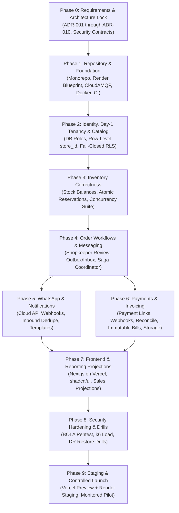

# Implementation Roadmap & Phase Exit Criteria

## Grocery Store Management & WhatsApp Ordering Platform

**Status:** Implementation Roadmap (Dependency-Ordered, Deployment-Aware & Hardened)  
**Governing Documents:** Spec v2.0 §20, Baseline v3.0 §17, `STYLE.md`  
**Target Topology:** Vercel (Frontend) + Render (Backend Services, Workers, Postgres) + CloudAMQP (RabbitMQ)  

---

## 1. Roadmap Principles & Strict Dependency Ordering

The platform architecture enforces strict dependency boundaries:
- **Zero Coding on Unapproved Invariants:** No application code may be written until the corresponding Architecture Decision Records (ADRs) are approved by designated owners.
- **Mandatory Day-1 Tenant Isolation:** Tenant data isolation and least-privilege database roles must be enforced and tested from **Day 1 in Phase 2**, never deferred to late hardening.
- **Dependency Invariant:** Downstream services cannot be implemented before their foundational upstream contracts exist. For example:
  - Inventory concurrency must be proven before Order placement can be completed.
  - Order state machine must be proven before Payment links can be issued.
  - Payment provider and WhatsApp Business Account decisions must be approved before their integration adapters are coded.
- **Deployment-Aware Validation:** Every phase validates its architecture against Vercel edge rules, Render private network isolation, Render Postgres connection budgets (49 baseline / 76 scaled peak vs unconfirmed plan ceiling), and ephemeral filesystem constraints.

---

## 2. Phase-by-Phase Execution Plan

### Phase 0: Requirements, Architecture Lock & Security Contracts
- **Prerequisites:** Complete repository audit.
- **Scope:** 
  - Initialize Git version control baseline with `.gitignore`.
  - Author and review all 10 baseline ADRs (`ADR-001` through `ADR-010`), incorporating Vercel + Render topology, internal 3-part identity security contract, CloudAMQP messaging, and schema-per-service on Render Postgres.
  - Formulate connection budget calculations (49 baseline / 76 scaled peak connections) and mark capacity unconfirmed until plan purchase.
  - Define object-storage abstraction (`StorageServicePort`).
  - Secure explicit owner approvals for payment provider, tax jurisdiction, WhatsApp Cloud API setup, and hosting budgets.
- **Key Risks:** Premature implementation without approved business decisions leading to architectural churn.
- **Acceptance Tests / Evidence:** All 10 ADRs reviewed and stamped with explicit approval status in `decision-register.md`.
- **Exit Criteria:** Zero unresolved blockers for Phase 1 and Phase 2.
- **Owner Approval Required:** System Architect, Security Lead, Product Owner, Finance Lead, DevOps Lead.

---

### Phase 1: Repository and Platform Foundation
- **Prerequisites:** Phase 0 completion (ADR-001, ADR-002, ADR-008, ADR-009 approved).
- **Scope:**
  - Initialize `pnpm` monorepo structure (`apps/`, `packages/`).
  - Configure root `tsconfig.json` with strict type checking.
  - Set up ESLint and Prettier rules enforcing import boundaries.
  - Author Render Blueprint (`render.yaml`) defining 1 Web Service (Gateway), 5 Private Services, 3 Background Workers, and Render Postgres.
  - Configure runtime `process.env.PORT` binding across all service templates.
  - Configure database connection pools with strict per-process limits (`max: 5` for APIs, `max: 3` for workers) and verify PgBouncer prepared-statement compatibility and driver configuration (evaluating named vs. unnamed statements and pooler transaction settings).
  - Create `docker-compose.yml` mirroring production (PostgreSQL 16, RabbitMQ 3.13, Redis 7) for zero-friction local development.
  - Build `packages/observability` (Pino logging with secret redaction and correlation ID propagation).
  - Build `packages/api-contracts` (shared Zod schemas) and `packages/event-contracts`.
  - Establish GitHub Actions CI pipeline running lint, format, typecheck, and build.
- **Key Risks:** Flaky CI pipelines or improper Render private network host resolution.
- **Acceptance Tests / Evidence:**
  - `pnpm run build` succeeds across all workspaces.
  - Docker Compose starts healthy local containers.
  - Render Blueprint validates via syntax/capability check.
- **Exit Criteria:** Every microservice template boots with `/health/live` and `/health/ready` endpoints responding.

---

### Phase 2: Identity, Multi-Tenancy, and Product Catalog
- **Prerequisites:** Phase 1 completion (ADR-002, ADR-003, ADR-010 approved).
- **Scope:**
  - Configure PostgreSQL schemas `identity` and `catalog` with dedicated least-privilege roles (`grocery_identity_user`, `grocery_catalog_user`).
  - Build `identity-service`: Argon2id password hashing, user registration, and store memberships.
  - Implement JWT/session cookie minting with trusted `store_id` claims.
  - Build `catalog-service`: categories, products, product variants (SKUs), and canonical units of measure.
  - Implement price history snapshots and public catalog read APIs with pagination and search.
  - **Mandatory Day-1 Multi-Tenancy:** Enforce row-level `store_id` query scoping across all tables and endpoints with canonical RFC 4122 UUIDv4 input validation.
  - **Fail-Closed RLS Integration:** Implement supplementary transaction-local RLS policies (`SELECT set_config('app.current_store_id', $1, true)`) within explicit transactions.
  - **Controlled Error Mapping:** Map missing context to `401`, malformed UUID to `400`, unauthorized store access to `403`, and store mismatches to `404`.
- **Key Risks:** Inadequate tenant scoping allowing cross-tenant catalog leaks.
- **Acceptance Tests / Evidence:**
  - **Multi-Tenant Isolation Gate:** Automated test creating Store A and Store B; verify Store A credentials cannot read or mutate Store B catalog items.
  - **Fail-Closed RLS Gate:** Query executed without setting `app.current_store_id` returns exactly zero rows.
  - **Malformed Tenant Gate:** Query with non-UUID string fails with `400 Bad Request` prior to database execution.
  - **Object-ID Guessing (BOLA) Gate:** Verify attempts to access resources by guessing IDs fail with `403` or `404`.
  - **Database Role Boundary Gate:** Verify `grocery_catalog_user` is physically blocked from querying `identity.*` tables (`permission denied for schema identity`).
  - **Password Security Gate:** Argon2id hash complexity verified via automated unit test.
- **Exit Criteria:** Verified token authentication and catalog CRUD operational with strict tenant isolation.

---

### Phase 3: Inventory Correctness and Concurrency Controls
- **Prerequisites:** Phase 2 product catalog schema.
- **Scope:**
  - Configure PostgreSQL schema `inventory` with dedicated role `grocery_inventory_user`.
  - Build `inventory-service`: `stock_balances` and append-only `stock_movements` ledger.
  - Implement atomic all-or-nothing multi-item reservation endpoint (`POST /reservations`).
  - Enforce deterministic ascending SKU sort order during row locking (`SELECT ... FOR UPDATE`).
  - Implement reservation release and manual stock adjustment endpoints with optimistic checks.
  - Implement reservation expiration background worker.
- **Key Risks:** Database deadlocks and inventory overselling under concurrent checkout spikes.
- **Acceptance Tests / Evidence:**
  - **Mandatory Concurrency Gate:** 100 concurrent reservation requests attempting to reserve 10 available units of SKU X: exactly 10 succeed, 90 receive `INSUFFICIENT_STOCK`, stock ends at exactly 0, and zero deadlocks occur.
- **Exit Criteria:** Concurrency test suite passes with zero failures.

---

### Phase 4: Order State Machine and Distributed Workflows
- **Prerequisites:** Phase 2 (Catalog) and Phase 3 (Inventory) completed (ADR-007, ADR-009 approved).
- **Scope:**
  - Configure PostgreSQL schema `order` and `billing` with dedicated role `grocery_order_user`.
  - Build `order-service` (hosting co-located Billing module): order intent submission with idempotency keys.
  - Implement `AWAITING_SHOPKEEPER_REVIEW` state machine.
  - Implement shopkeeper review, quantity adjustment, and substitution API.
  - Implement atomic reservation trigger upon shopkeeper confirmation.
  - Implement Transactional Outbox pattern publishing `OrderConfirmed.v1` and `OrderCancelled.v1` to CloudAMQP with publisher confirms.
  - Implement Order Saga state machine coordinator (`order_sagas` table) with compensating release actions.
- **Key Risks:** Worker crashes mid-transaction resulting in uncommitted reservations or lost outbox events.
- **Acceptance Tests / Evidence:**
  - **Review Invariant Test:** Submit order; verify stock remains unreserved until shopkeeper executes confirm API.
  - **Broker Outage Recovery Test:** Sever connection to CloudAMQP; approve order; verify order commits to PostgreSQL; reconnect CloudAMQP; verify outbox worker flushes event with publisher confirms.
  - **Consumer Deduplication Gate:** Deliver duplicate event payload; verify consumer inbox drops duplicate without re-executing.
- **Exit Criteria:** Order state machine transitions validated; transactional outbox reliable under simulated broker outage.

---

### Phase 5: WhatsApp Business Cloud API Integration and Notifications
- **Prerequisites:** Phase 4 order workflow (ADR-006 approved).
- **Scope:**
  - Configure PostgreSQL schema `notification` with dedicated role `grocery_notification_user`.
  - Build `notification-worker` (Render Background Worker).
  - Implement `POST /api/v1/webhooks/whatsapp` receiver on API Gateway (forwarding raw unparsed body).
  - Implement raw request body HMAC-SHA256 signature verification (`X-Hub-Signature-256`).
  - Implement inbound message deduplication table (`inbound_whatsapp_messages`).
  - Implement verified business-number-to-store tenant mapping.
  - Implement conversational state machine (greeting, catalog list, order intent, review updates).
  - Implement CloudAMQP event consumer for order status updates, dispatching pre-approved Meta message templates outside 24h window.
- **Key Risks:** Webhook forgery, duplicate reply loops, or WhatsApp API rate-limiting blocks.
- **Acceptance Tests / Evidence:**
  - **Webhook Security Test:** Send webhook with invalid HMAC signature; verify `401 Unauthorized`.
  - **Inbound Deduplication Test:** Deliver identical WhatsApp message ID 3 times; verify exactly 1 reply generated.
- **Exit Criteria:** End-to-end simulated WhatsApp ordering conversational flow passes.

---

### Phase 6: Payments, Billing, and Invoice Generation
- **Prerequisites:** Phase 4 order confirmation and Phase 5 notification dispatcher (ADR-004, ADR-005 approved).
- **Scope:**
  - Configure PostgreSQL schema `payment` with dedicated role `grocery_payment_user`.
  - Build `payment-service` with provider-agnostic adapter architecture.
  - Implement payment link creation API for confirmed orders in integer minor units (paise).
  - Implement provider webhook receiver with raw signature validation and deduplication inbox.
  - Implement background reconciliation cron for `UNKNOWN` payment outcomes.
  - Build `billing` module inside `order-service`: generate immutable invoice snapshots, sequential store invoice numbers, and calculate taxes.
  - Implement `StorageServicePort` adapter: upload generated invoice PDFs directly to Cloud Object Storage via pre-signed URLs.
  - Issue credit notes on cancellations.
- **Key Risks:** Financial drift, double charging, floating-point rounding errors, unverified client redirect fraud.
- **Acceptance Tests / Evidence:**
  - **Non-Authoritative Client Test:** Verify browser redirect cannot mark an order paid without verified provider webhook.
  - **Webhook Replay Test:** Post duplicate payment capture webhooks; verify payment recorded exactly once.
  - **Object Storage Access Gate:** Verify invoice PDFs require authenticated pre-signed URLs to download.
  - **Tax Rounding Test:** Verify itemized bill calculations across fractional items match invoice grand totals to the exact minor unit.
- **Exit Criteria:** Payment lifecycle and invoice generation validated against provider sandbox.

---

### Phase 7: Management Dashboard, Reporting, and Customer Web UI
- **Prerequisites:** Phase 2 through Phase 6 backend APIs.
- **Scope:**
  - Build `apps/web` on **Vercel** using **Next.js (App Router)**, Tailwind CSS v4, and shadcn/ui strictly adhering to `STYLE.md`.
  - Configure CORS allowlists on Render API Gateway for Vercel production and preview domains.
  - Implement compact, dense shopkeeper operations console: order review, item substitution, fulfillment dispatch, and inventory adjustment.
  - Implement responsive customer catalog, search, cart, and payment link completion pages.
  - Configure PostgreSQL schema `reporting` with dedicated role `grocery_reporting_user`.
  - Build `reporting-worker`: consume CloudAMQP domain events into read-optimized PostgreSQL projections (`daily_sales_projections`, `inventory_alert_projections`).
- **Key Risks:** Visual bloat or generic styling violating `STYLE.md`; slow frontend data tables.
- **Acceptance Tests / Evidence:**
  - Full Playwright E2E test suite: customer submits order $\rightarrow$ shopkeeper reviews and adjusts quantity $\rightarrow$ stock reserved $\rightarrow$ invoice generated $\rightarrow$ payment link clicked $\rightarrow$ order completed.
  - `STYLE.md` pre-ship checklist audit passed.
- **Exit Criteria:** Staff dashboard and customer web interfaces fully functional with responsive layouts and accessible focus states.

---

### Phase 8: Production Hardening, Security Pentest, and Recovery Drills
- **Prerequisites:** Integrated end-to-end system.
- **Scope:**
  - Execute automated security penetration tests (BOLA, IDOR, SQL injection, CSRF, rate-limit bypassing).
  - Run k6 performance load tests targeting 10x anticipated traffic; measure p50, p95, p99 latencies, Render Postgres pool saturation, and queue lag.
  - **Render Graceful Shutdown Gate:** Send `SIGTERM` to `order-service`; verify in-flight transactions commit and process exits within 25 seconds (under Render's 30s deadline).
  - **Ephemeral Storage Gate:** Audit all services to guarantee zero durable state is stored on container local disk.
  - **Disaster Recovery Restore Drill:** Execute automated database restore drill on Render Postgres backup; measure actual RPO and RTO against provisional targets ($\le 1$h RPO, $\le 2$h RTO).
  - Rehearse dead-letter queue replay and provider outage procedures.
  - Write operational runbooks (`docs/runbooks/`).
- **Key Risks:** Latency spikes under database connection pool exhaustion; unverified backup scripts.
- **Acceptance Tests / Evidence:**
  - Clean security scan with zero critical or high vulnerabilities.
  - Documented restore drill proving RTO $\le 2$ hours and RPO $\le 1$ hour.
- **Exit Criteria:** Production release gate sign-off documented and approved.

---

### Phase 9: Controlled Staging and Production Launch
- **Prerequisites:** Phase 8 sign-off.
- **Scope:**
  - Deploy to staging environment on Vercel preview + Render staging with real provider sandboxes (Meta Cloud API, Payment Provider Sandbox).
  - Conduct pilot dry runs with selected grocery store merchant.
  - Verify alerts, dashboards, and error budgets.
  - Execute production rollout following documented rollback procedures.
- **Exit Criteria:** System operational in production with active monitoring and zero unresolved release blockers.
